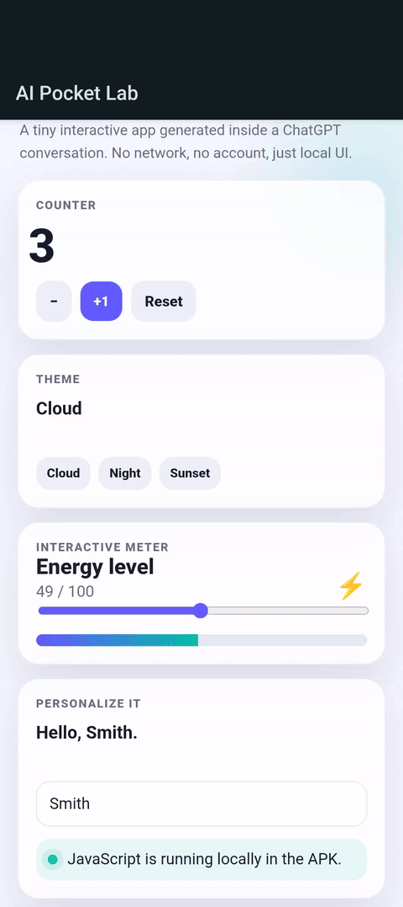

Redditで、["Huge implications - binaries are now basically editable code"](https://www.reddit.com/r/accelerate/comments/1w8wzig/huge_implications_binaries_are_now_basically/)というタイトルの投稿を見かけました。

投稿では、バイナリからソフトウェアをリバースエンジニアリングする能力を測る[ReverseEngBench](https://www.vals.ai/benchmarks/srebench)[^1]に対して、GPTが非常に高い性能を出したという話が紹介されています。

[^1]: 公開当初はSRE Benchという名前だったが、Site Reliability Engineeringとの混同を避けるため名称が変更された: <https://x.com/ValsAI/status/2087978262819688926>

この投稿を見て、AIにとってバイナリは人間にとってのソースコードのように読み書きできるものになりつつあるのではないかと考えました。もしそうなら、AIはソースコードを生成してコンパイラに渡すだけでなく、実行ファイルそのものを生成したり、生成済みのバイナリを解析して問題のある部分を直接修正したりできるはずです。

そこで、普段使っているAndroid版ChatGPTから実際にELFとAPKを作らせ、どこまでできるのか試してみました。

## 注意

この記事では、AIが生成したELFやAPKを実際に端末で実行しています。信頼できない実行ファイルやAPKの実行・インストールにはセキュリティ上のリスクがあるため、同様のことを試す場合は内容を確認し、必要に応じてエミュレータや検証用端末を使用してください。

また、元になった話題にはバイナリのリバースエンジニアリングも含まれますが、この記事で扱うのは自分で生成したプログラムのみです。他者のソフトウェアを解析・改変する場合は、ライセンス、利用規約、適用される法律などを確認してください。

## 試した環境

試した日と環境は次のとおりです。

- 日付: 2026年9月7日
- ChatGPT: Androidアプリ。モデルは記録していませんが、当時の設定は5.6 highだったと思います。
- 端末: Pixel 10（Android 17）

この記事に書いたAPK署名ブロックとDEXバイトコードの誤りの内容は、ChatGPTの説明に基づくものです。`apksigner`や`dexdump`などのツールを使って、自分で別に確かめてはいません。

## まずELFを直接生成する

最初に、「試しにLinuxで動くバイナリが作れるなら作って」とChatGPTに依頼しました。

ChatGPTはPythonを使ってELFヘッダとx86-64の機械語を表すバイト列を組み立てて、ELFファイルを生成しました。この処理ではコンパイラなど通常のビルドツールは使っていません。手元のLinux環境で実行すると正常に動作しました。

```
$ ./hello-ai-elf-x86_64
Hello from an ELF generated directly by AI-style byte construction!
```

もちろん、これは`write(2)`で文字列を出力して終了するだけの小さなプログラムです。Hello Worldを機械語やアセンブリで書いたことがあれば、技術的には特に不思議なことではありません。

しかし、AIがバイナリを直接生成できるかという最初の問いについては、少なくともこの規模ならすでに可能でした。

## APKを直接組み立てる

続いて、「バイナリにこだわらなくていいからAPKを作ってみて。モバイルアプリを作ったことがないから、動くものをとにかく見てみたい」と依頼しました。

AIと自然言語で対話しながらモバイルアプリを作ること自体は、すでに[Replit](https://replit.com/usecases/ai-app-builder)などで可能です。今回試したかったのは、AIにアプリ開発を任せることそのものではなく、通常はビルドツールが生成するAPKの内部形式までAIが直接扱えるかという点です。

通常のAndroid開発では、KotlinやJavaなどでアプリを書き、GradleとAndroidのビルドツールを使ってAPKを生成します。[D8](https://developer.android.com/tools/d8)はコンパイル済みのJavaバイトコードなどをAndroid Runtime（ART）が実行できるDEXバイトコードへ変換し、[AAPT2](https://developer.android.com/tools/aapt2)はリソースのコンパイルやパッケージ化を担います。最終的なAPKには`classes.dex`や、処理済みの`AndroidManifest.xml`などが格納されます。

開発者が`classes.dex`のバイトコード命令や、APK内に格納されるバイナリXML形式の`AndroidManifest.xml`を直接組み立てることは通常ありません。これらは、普段はAndroidのビルドツールによって生成されるものです。

当初、ChatGPTもAndroid SDKを利用した通常のビルドを試そうとしていました。しかし、実行環境からSDKを取得できず、生成中に方針が変わりました。

> Android 17 は API 37 なので、`compile/target SDK 37` 相当で考えます。SDK の通常ダウンロードがこの実行環境では塞がれているため、むしろ今回のテーマに合う形で、DEX と AndroidManifest をこちらで直接組み立てて APK にする方向に切り替えています。

今回は、Android StudioやGradleだけでなく、D8やAAPT2などの通常のビルドツールも使わず、ChatGPTがDEXバイトコードとバイナリXML形式の`AndroidManifest.xml`を生成し、APKを組み立てました。

Android 17の端末にインストールしてみたところ、Package Installerは`You can't install the app on your device.`と表示し、インストールを拒否しました。

## APK署名の問題を追う

端末側では詳しいエラーが表示されなかったため、その状況をそのままChatGPTに伝えました。するとChatGPTは生成済みのAPKを調べ、最初に署名を疑いました。

最初のAPKにはv1のJAR署名しかなかったため、[APK署名スキームv2](https://source.android.com/docs/security/features/apksigning/v2)のAPK署名ブロックを追加した修正版が生成されました。しかし、そのAPKもインストールできませんでした。v2署名を追加しただけでは問題が解決しなかったため、今度は自分で生成したAPK署名ブロックそのものを調べ直します。

> 前回こちらで手実装した v2 署名ブロックに長さプレフィックスが数か所1段足りないという実装ミスがありました。Android側から見ると「v2署名があるように見えるが形式が壊れている」状態です。

APK署名スキームv2では、署名者、ダイジェスト、署名などが長さ情報を持つデータ構造としてネストしています。最初の実装ではその長さ情報の一部が不足していました。

通常のAndroid開発では、アプリ開発者がAPK署名スキームの内部構造を自分で組み立てることはありません。署名ツールがこの処理を担当します。今回はその部分までChatGPTが生成していたため、問題が起きた後も生成済みのAPK署名ブロックを仕様に沿って解析し、構造そのものを修正することになりました。

修正版はインストールできましたが、起動するとすぐに終了しました。

## DEXバイトコードをデバッグする

起動直後に終了することを伝えると、ChatGPTはActivityの実装を含む`classes.dex`を調べ始めました。一度は手作りしたDEXを捨て、D8を使って`classes.dex`を生成する方法も検討していましたが、ビルドツールの取得にも制約があり、最終的には自分で生成したDEXバイトコードを直接解析しました。

そこで見つかったのが、Dalvikバイトコードの`invoke-super`、`invoke-direct`、`invoke-virtual`命令のエンコードミスです。

> `classes.dex` の Dalvik 命令を分解すると、`invoke-super` / `invoke-direct` / `invoke-virtual` の引数個数を入れる4bitとレジスタ番号を入れる4bitを逆にエンコードしていました。

より正確には、Dalvikバイトコードの[命令形式35c](https://source.android.com/docs/core/runtime/instruction-formats)で、引数ワード数を表すAフィールドと、引数レジスタを表すGフィールドを逆に配置していました。

例えば、`Activity.onCreate(Bundle)`を呼び出す`invoke-super`では、先頭のコード単位が次のように修正されました。

```text
before: 0x026f
after:  0x206f
```

同じ問題があった`invoke-direct`と`invoke-virtual`も修正し、DEXヘッダのSHA-1ハッシュ（`signature`フィールド）とAdler-32チェックサムを再計算した上でAPKを作り直しました。

通常であれば、アプリがこのようにクラッシュしたときはKotlinやJavaなどのソースコードを修正し、ビルドツールにDEXを作り直させます。しかし、ChatGPTはソースコードからやり直すのではなく、生成済みの`classes.dex`を解析し、問題のあるバイトコード命令そのものを書き換えています。

## Android 17で起動する

DEXバイトコードを修正したAPKを端末へ送ると、Android側では既存アプリの更新として認識され、Updateボタンが表示されました。しかし、更新を実行すると`Something went wrong. App not installed.`と表示されました。

これは実装上の問題ではなく、修正版を作るたびに新しい署名鍵と証明書を生成していたことが原因でした。同じアプリケーションIDのAPKを[既存アプリの更新](https://developer.android.com/google/play/app-updates)としてインストールするには、署名証明書についても既存バージョンとの互換性が必要です。

既存のアプリを一度アンインストールし、DEXバイトコードを修正したAPKを新規インストールすると、今度はActivityが正常に起動しました。


## もう少しアプリらしいものを作る

最小のActivityが動いた後、「いくつかボタンやデザインなど機能を作ってみてください」と依頼しました。

ここではAPK全体をバイト列として直接生成することにはこだわらず、ChatGPTはAndroidのActivityからWebViewを開き、APK内に埋め込んだHTML、CSS、JavaScriptを表示する構成を選びました。



## 感想

今回最も印象に残ったのは、AIがAPKを生成するだけでなく、自分で生成したAPK自体をデバッグできたことです。通常ならビルドツールが生成するAPKの内部形式まで組み立て、動かなければ生成済みのAPKを解析し、APK署名ブロックや`classes.dex`のバイトコードを直接修正しました。単にAndroidアプリのコードを生成したのではなく、生成物のフォーマットそのものを扱いながら問題を修正していた点が興味深く感じました。

今回の結果から、コンパイラやビルドツールが不要になるとは言えません。一般的なソフトウェア開発では、既存のツールチェーンを利用する方が効率的で、再現性も高いと考えます。一方、AIを介することで、ソースコードだけでなく中間表現やバイナリまで必要に応じて調査や修正の対象にすることは以前より現実的になったように思います。

私が以前BGPの問題を切り分けたときにも、BGP OPENメッセージをバイト列から直接組み立てる小さなPythonスクリプトをAIに書かせたことがありました。こうした低レイヤーの調査は以前から可能でしたが、そのためだけに仕様を調べ、使い捨てのスクリプトを書くコストは小さくありません。AIによって、必要なときに低いレイヤーに降りるハードルはかなり下がったように感じます。

少なくとも今回の実験を通して、最初に見た"binaries are now basically editable code"という表現を、以前より実感を持って捉えられるようになりました。

この記事は、2026年9月にはてなブログで公開したものを移転しました。
