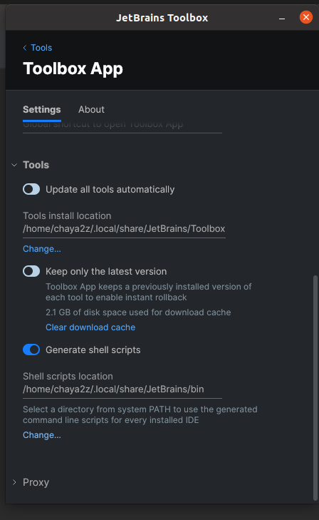
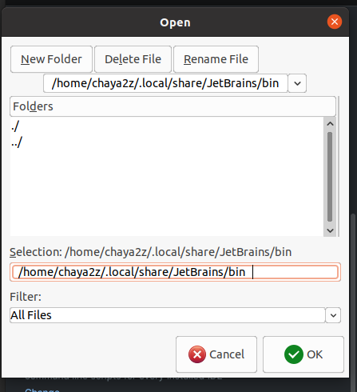

この記事は [ITRC Advent Calendar 2021](https://adventar.org/calendars/6368) の14日目の記事です．

## やりたいこと

コマンドラインから Jetbrains の IDE を起動できるようにする．例えば以下のような感じのことをできるようにする．

```bash
idea hoge.md
```

## 環境

- GNU/Linux Ubuntu Desktop 20.04

- Toolbox を使って IDE を管理しているとする．

## 設定手順

1.まずは Toolbox を開く．

2.ウィンドウの右上の六角形のマークを押下し「Settings」を開く ( もしくは `Ctrl + ,` を入力 ) ．

3.「 Generate shell scripts」にチェックを入れる．

4.任意の `~/` 以下のディレクトリを入力する (**`/usr/local/bin` には権限がなく書きこめないため** ) ．

5.入力欄の下の「 Change... 」を押下する．

6.ディレクトリ選択のダイアログが開く．**「 Selection 」の入力欄の末尾に謎の空白があるので削除する**．

7.「 OK 」を押下してダイアログを閉じる．

8.作成したディレクトリにパスを通す．

### 補足

この画面の「 Generate shell scripts」を設定する．ここでは `/home/chaya2z/.local/share/JetBrains/bin` を使っている．



「 Selection 」の入力欄の末尾に謎の空白がある



## 参考

- <https://pleiades.io/help/idea/working-with-the-ide-features-from-command-line.html>
