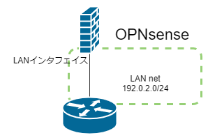
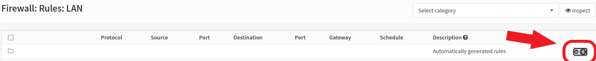
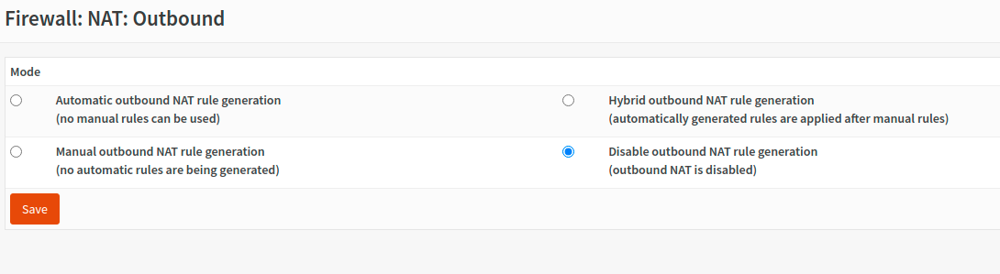

ところどころつまずいたので残します．

## LAN net という項目

例えば，LAN という名前のインターフェイスがあったとき，ファイアウォールのルールの Source や Destination の選択肢で「LAN address」や「LAN net」という項目が選べます．

この LAN net というのは **LAN インターフェイスが所属するネットワークだけ**を指し，それより下のネットワークのことではないです．

例えば、下図のように，LAN net が 192.0.2.0/24 であるとします．そのとき、送信先が LAN net のパケットを Reject する項目を追加しても，192.0.2.0/24 しか Reject しません．\
つまり，下図のルータの下に 192.0.2.0/24 以外のネットワークがあったとしても，そのネットワークは LAN net の対象ではないということです．



## 自動生成されるファイアウォールルールを確認する

自動生成されるルールはウェブページを開いたときに隠れているので，表示して確認します．



ここにトラブルの原因があるかも知れません．

## ファイアウォールルールの順番確認する

まずはドキュメントを参照するといいです．\
<https://docs.opnsense.org/manual/firewall.html>

ドキュメントによると，ファイアウォールは次の順番で評価されます．

1. Floating ( 全インタフェイス ) での設定
2. グループでの設定
3. インターフェイスごとの設定

**表の上のものが優先されて**評価されます．

## NATルールを確認する

恐らくデフォルトで有効になっています．

NAT しない場合は「Disable outbound NAT rule generation」を選択するといいです．



## WEB GUIに繋げなくなったとき

ファイアウォールの設定を消してしまい，WEB GUI への接続がはじかれてしまったときの対処法を説明します ( CLI が使えることが前提 )．

`pfctl` コマンドを使って CLI から pf ( BSD 系 OS のパケットフィルタ ) の設定を行います．

```
pfctl -d
```

`-d` は disable のことで，ファイアウォールを無効にします．\
これで WEB GUI に繋がるので、設定を再開できます．

再び有効にするには WEB GUI で設定を適用するか，`pfctl` コマンドを使います．

```
pfctl -e
```

`-e` は enable のことで，ファイアウォールを有効にします．

## 同じネットワークのアドレスをインターフェイスに振ってはいけない

2つ以上のインターフェイスに同じネットワークの IP アドレスを振ると，その設定が無効化され接続できなくなります．

同じネットワークに所属させるために bridge 機能があります ( この記事では説明しませんが )．
